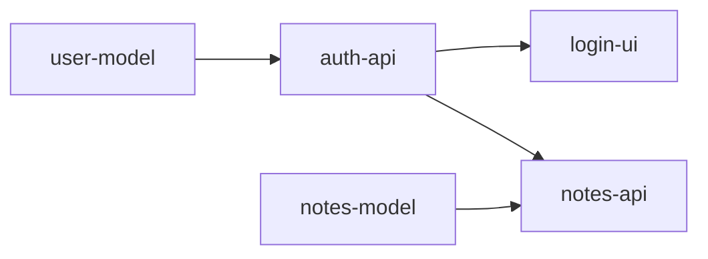

Produce one spec + implementation-plan pair per component, emitted as files `build-brief` later consumes.

## Input

The invocation names the design-doc source and what to plan; the source defaults to `docs/design/`. When the folder carries a `| Doc | Scope |` index (its `CLAUDE.md`), pick the docs from it before reading wholesale.

A named feature carves its sections out of the docs; everything else in them is standing context the plan must respect. When the work is the next thing baked, the project's `TODO.md` task table holds the row. `git show <commit> -- <docs>` on its bake commit bounds the newly baked design. A source doc that defines nothing to construct is flagged, not planned. No docs at the named or default location: stop and ask where they live.

Ground the boundary on the code, not the docs: what exists in code is already built (reuse or extend); what is absent is this build. Grep the codebase for every contract the feature names, read the signatures the plan consumes from the code as built, and surface a doc-vs-code mismatch as a finding rather than planning against the doc's version.

Also read `OPEN-QUESTIONS.md` when present: non-empty flags the affected area as not baseline.

## Decompose by component

A component is the smallest unit that can be spec'd, planned, built, and acceptance-gated INDEPENDENTLY. It shares no state or internals with its neighbors.

State the proposed components before writing.

## Seams before specs

Sketch the seams at which each component will be tested. Prefer existing seams to new ones and keep the new-seam count low: the ideal is one new seam across the build, placed at the highest point that works.

Check with the user that the seams match their expectations before writing the specs.

## Order by dependency

Foundation-first.

Cross-ref graph: referenced-by-many → early (foundation). References-many → late (UI/edge). Within what dependencies allow, highest uncertainty first.

## Emit per component → `docs/plan/`

One spec + one plan per component, no third doc:

```markdown
# <component> — spec

## What and why

## Success criteria

## Implementation decisions

## Testing decisions

## Out of scope
```

```markdown
# <component> — plan

Decisions likely to change: <calls most likely to be revisited>

## Global constraints

## Interfaces

## Checklist
```

What the skeletons cannot show:

- Every success criterion is checkable (a test that passes, a query that returns X), never "works" or "is good". Out of scope is mandatory beyond trivial scope. Leave zero design decisions for the implementer.
- Implementation decisions carry no file paths or code snippets (they go stale fast); exception: a prototype snippet that encodes a decision more precisely than prose, trimmed to the decision-rich parts. Testing decisions say what makes a good test here: external behavior through the agreed seams, which modules are tested, prior art in the codebase.
- Global constraints copy VERBATIM from the design docs: exact values, version floors, naming rules, one line each. Downstream reviewers use this block as their attention lens, so exact values travel, not paraphrases.
- Interfaces: **Consumes** is the exact signatures this component uses from earlier components; **Produces** is the exact names, parameter types, and return types later components rely on. A fresh-context builder sees only its own spec+plan; this block is how it learns its neighbors' names and types.
- Checklist: numbered steps as `[Step] → verify: [check]`, decisions likely to change listed first. Each step is one verifiable action; fold setup, configuration, and scaffolding into the step whose deliverable needs them; no standalone scaffolding steps.

**Distill, do not invent.**

A spec carries only decisions the canonical set already holds: no new schema, contract, or prompt-template calls. Anything missing is flagged, never invented.

## No placeholders

A placeholder is filler that reads like a step but carries no decision — a hole in the design or a vague draft. Flag it, never paper over it. The failure shapes:

- "TBD", "TODO", "implement later", "fill in details"
- "Add appropriate error handling" / "add validation" / "handle edge cases"
- "Write tests for the above" (name the test and what it asserts)
- "Similar to component N" (repeat the content: steps may be read out of order)
- References to types, functions, or interfaces no spec or plan defines

## Self-review before emitting

Run this checklist yourself over the drafted files, not as a subagent dispatch:

1. **Spec coverage:** skim each requirement in the source design. Can you point to the step that implements it? List any gaps; add the missing component or step.
2. **Step scan:** every step must leave exactly one reasonable implementation action and no more: resolve placeholders, and remove detail the signature, tests, or project conventions already determine.
3. **Type consistency:** do the names, signatures, and property types used by later components match what earlier components produce? A `clearLayers()` produced in one component but consumed as `clearFullLayers()` in another is a build-time failure.
4. **Distill audit:** can every spec statement be traced to the canonical set? Coverage (1) catches what the plan lacks; this catches what the plan invents.
5. **Criteria checkable:** every success criterion is a mechanical check, never "works" or "is good".
6. **Failure-mode coverage:** for each realistic input class or failure mode the design implies, point to the step or test that covers it, or to an explicit out-of-scope decision.

Fix issues inline. No re-review: fix and move on.

## INDEX → `docs/plan/INDEX.md`

INDEX = the cross-feature component list with dependency ordering. Working terms are feature / INDEX / component only.

The shape, on a two-feature example:

```markdown
# Plan INDEX

Ordered by dependency, within and across features.

## auth-flow

1. user-model
2. auth-api (consumes: user-model)
3. login-ui (consumes: auth-api)

## notes

1. notes-model
2. notes-api (consumes: notes-model; auth-api)
```

Rows are born bare; the only later mark is `· plan-reviewed`, added when an independent review passes. The file ends with a `## Dependency graph` section — one mermaid block drawn from the rows' consumes annotations (they are authoritative; the graph is the human-readable render):



## Gate

Print the component list + dependency order for review, then iterate with the user on the artifacts: fix what reads wrong, settle the decisions likely to change. Propose `plan-review` when the plan warrants an independent pass; the choice is the user's. At the gate's close, when the project keeps a `TODO.md`, advance the feature row in it to the chosen next step (review the plan when an independent pass is chosen, build when declined), and commit the advance and the new `docs/plan/` content. `build-brief` follows when review passes or is declined.
